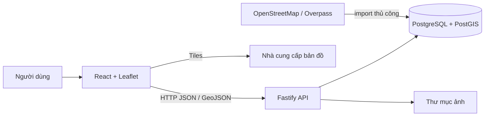
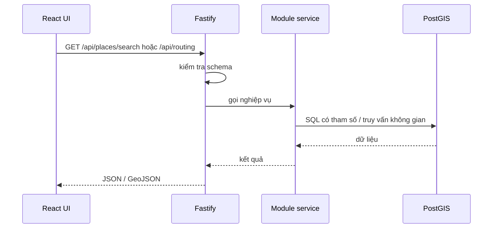

# Kiến trúc hệ thống

Ứng dụng theo mô hình client–API–database; không có message queue hay microservice.



- **Frontend (`frontend/src`)** quản lý bản đồ, tìm kiếm/lọc, lựa chọn, chỉ đường và quản trị. `services/` gọi API; `store/` giữ state dùng chung; `components/Map` trình bày Leaflet.
- **Backend (`backend/src`)** khởi tạo Fastify ở `app.ts`, kiểm tra cấu hình bằng Zod, route qua các module `categories`, `places`, `routing`, `uploads`; service truy vấn qua `db/pool.ts`.
- **PostgreSQL/PostGIS** lưu danh mục, địa điểm, geometry và graph routing. Migration ở `sql/migrations`; importer OSM là lệnh riêng.
- **Tiles/imagery** được trình duyệt tải từ nhà cung cấp bên ngoài, không phải dữ liệu do API campus phục vụ.



Giữ một backend và một SPA phù hợp quy mô dự án. PostGIS đảm nhiệm lưu trữ và truy vấn không gian. Routing ưu tiên OSM nếu có dữ liệu, duy trì `campus_paths` tương thích và ghép một số tuyến campus thủ công; đoạn nối ngoài mạng/fallback cần được nhận diện, không thay thế xác minh thực địa.

## Cấu trúc chính

```text
my-node-project/
├── backend/       # API, DB, importer, SQL, tests
├── frontend/      # React app, bản đồ, UI, admin, E2E
├── data/          # dữ liệu ví dụ
└── docker-compose.yml
```

Không di chuyển module trong đợt audit: các ranh giới hiện hữu có thể nhận biết và việc sắp xếp lại không đem lại lợi ích đủ lớn.
